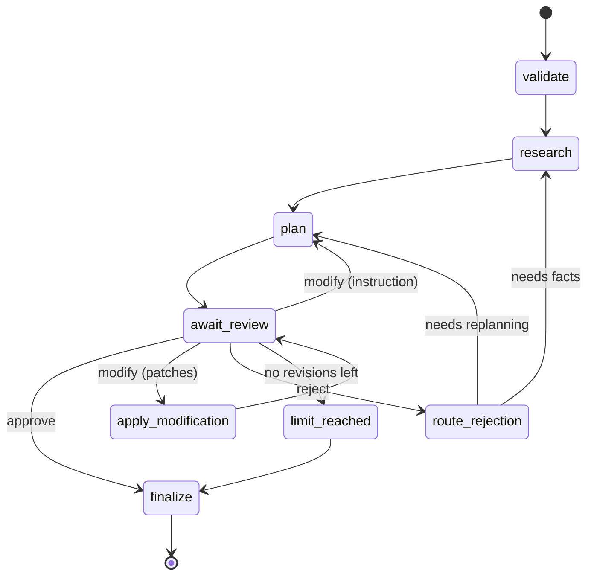

# AI Trip Planner

Multi-agent travel planning service with human-in-the-loop approval.

AI Trip Planner takes a travel request — destination, dates, budget range, interests and party
size — researches the destination against live sources, drafts a day-by-day itinerary,
and **pauses for human review** before producing a final plan. The workflow is a
LangGraph state machine served over FastAPI. Its paused state is checkpointed to disk,
so the review spans separate HTTP requests rather than a single blocking call, and
survives a restart of the process that started it.

---

## Contents

- [How it works](#how-it-works)
- [Setup](#setup)
- [Running](#running) · [The web console](#the-web-console)
- [API](#api)
- [Design decisions and tradeoffs](#design-decisions-and-tradeoffs)
- [Assumptions](#assumptions)
- [What I would do with more time](#what-i-would-do-with-more-time)
- [Production concerns](#production-concerns)
- [Development](#development)

---

## How it works



**Orchestrator** — a LangGraph `StateGraph`. It validates the request, routes work
between the agents, manages the transitions between researching, planning and approval,
and handles the interrupt. Everything left of `await_review` runs on the submission
request; everything right of it runs on a review request.

**Research agent** — gathers destination intelligence into a typed brief.

| Tool | What it does |
|---|---|
| `web_search` | Serper or Exa behind one interface. Per-run query budget; every returned URL is recorded for citation. |
| `destination_conditions` | Open-Meteo, no API key. A real forecast inside the ~16-day horizon, clearly labelled climate normals beyond it. |

**Itinerary planner agent** — turns the brief into a reviewable day-by-day plan.

| Tool | What it does |
|---|---|
| `budget_allocator` | Splits the budget across lodging, food, activities, transport and contingency, and converts it into the destination's currency via Frankfurter (keyless, ECB rates, carried with its quote date). |
| `day_feasibility_check` | Checks a proposed day against the daily envelope, the weather, pacing thresholds and how far it spreads across the city. Deterministic — no model call. |

**Human-in-the-loop** — the workflow pauses and surfaces the draft. Three actions:

| Action | Effect |
|---|---|
| `approve` | Finalised; packing and preparation lists are generated. |
| `reject` | Feedback is classified and routed to research or the planner; the revised draft comes back for review. |
| `modify` | Structured patches are applied deterministically with no model call; a free-text instruction goes back to the planner. Either way the result returns for review. |

Full design rationale: **[docs/architecture.md](docs/architecture.md)**.

---

## Setup

**Requirements:** Python 3.10 or newer.

```bash
git clone https://github.com/anaanyaww/ai-trip-planner.git ai-trip-planner
cd ai-trip-planner

python -m venv .venv
.venv/Scripts/activate        # Windows
# source .venv/bin/activate   # macOS / Linux

pip install -e ".[dev]"

cp .env.example .env
```

### API keys

**Everything runs with an empty `.env`.** With no model key the service boots, serves
every endpoint and passes its whole test suite against a deterministic offline
provider; `/ready` states plainly that plans will be placeholders. Add keys to get real
plans.

| Variable | For | Free tier | Needed? |
|---|---|---|---|
| `SERPER_API_KEY` | Web search (default) | 2,500 queries on signup | For real research |
| `EXA_API_KEY` | Web search (alternative) | 1,000 searches/month | Alternative to Serper |
| `OPENROUTER_API_KEY` | Primary — `nvidia/nemotron-3-super-120b-a12b:free` | Free `:free` model ids | For real plans |
| `GROQ_API_KEY` | Second — `qwen/qwen3.6-27b` | 8,000 tokens/min | Recommended |
| `GROQ_API_KEY_ALT` | A second Groq key, metered separately | Doubles the above | Optional |
| `GOOGLE_API_KEY` | Third — `gemini-3.5-flash-lite` | Free tier on AI Studio | Optional |
| *(none)* | Local models through Ollama — no key, no quota | Unlimited | Optional |

Each default was verified against all three call shapes the agents actually use — plain
completion, tool binding, and structured output. That last one rules out several
otherwise-capable free models: Groq's `gpt-oss` family, for instance, handles tool calls
but rejects the structured-output schemas the agents need. OpenRouter also rotates which
ids carry a `:free` tier, so check [openrouter.ai/models](https://openrouter.ai/models)
if that default starts returning 404.

Get them from [serper.dev](https://serper.dev) · [exa.ai](https://exa.ai) ·
[Groq](https://console.groq.com/keys) · [Google AI Studio](https://aistudio.google.com/apikey) ·
[OpenRouter](https://openrouter.ai/keys).

To use Exa instead of Serper, set **both** `SEARCH_PROVIDER=exa` and `EXA_API_KEY` —
setting only the key leaves the system asking Serper.

Weather, geocoding and currency conversion need no key at all.

The chain is expanded into one candidate per (provider, key, model) and tried in order,
so a refusal moves to the next *model or key* before it moves to the next vendor — which
is what free tiers actually meter. Listing more of either widens the chain for free.

### Running models locally

[Ollama](https://ollama.com/download) removes the quota question entirely. Name it in
the chain, ahead of the hosted providers, and it absorbs the load until it struggles:

```bash
ollama pull qwen3:4b
# .env
LLM_PROVIDER_CHAIN=ollama,openrouter,groq,gemini
```

Local models are weaker at the two things the agents need — tool calling and structured
output — so keeping hosted providers behind them is the point, not a hedge. Measured on
a 4 GB card against the planner's real schema: `qwen3:4b` answers in ~17s and `qwen3:1.7b`
in ~8s, while `granite4.1:3b` and `llama3.2:3b` bind tools correctly but return an empty
object. Keep `OLLAMA_NUM_CTX` inside what the GPU can hold — the same 4B model took 371s
at a 64K window and 17s at 16K, because the KV cache had spilled into system RAM.

### If every outbound call fails with a certificate error

`SSL_USE_SYSTEM_TRUST_STORE=true` (the default) verifies TLS against the operating
system's trust store instead of the `certifi` bundle. Corporate proxies, VPN clients and
some antivirus products terminate TLS and re-sign it with a private root that the OS
trusts and `certifi` does not — which fails every search, weather, currency and model
call with `CERTIFICATE_VERIFY_FAILED` on a machine where the same URLs open fine in a
browser. Set it to `false` only if your deployment needs the bundled authorities.

Every value in `.env.example` is documented inline, including each provider's free-tier
limits and the reasoning behind each cache TTL. Nothing is hardcoded: models, provider
order, thresholds, budget ratios, TTLs and timeouts are all configuration.

### Database

```bash
alembic upgrade head          # or: make migrate
```

Not strictly required — the service creates any missing tables at start-up so a fresh
clone runs — but Alembic owns schema evolution from here.

---

## Running

```bash
uvicorn itinera.main:app --reload     # or: make run
```

| Surface | Where |
|---|---|
| Web console | **http://127.0.0.1:8000/** |
| Interactive API documentation | **http://127.0.0.1:8000/docs** |

| Endpoint | Purpose |
|---|---|
| `GET /health` | Liveness — is the process up |
| `GET /ready` | Readiness — can it serve a plan; reports the active model chain |

### The web console

The console walks one plan through the whole workflow: submit a request, watch the
stage advance from research to draft, read the itinerary, then approve, reject with
feedback, or modify it directly. It is a *client* of the four endpoints below and holds
no state the server does not — every screen is re-derived from `GET /plan/{id}`, and the
plan id lives in the URL fragment, so reloading mid-run resumes the plan rather than
losing it. Anything the console can do is equally doable from `/docs` or `curl`.

Modify supports the structural patches directly — remove an activity, set a day's notes,
set the lodging preference, add or replace an activity — and applies them without a model
call. A written instruction is available in the same place, and is handed to the planner
instead.

While a run is in flight the console shows what the agents are actually doing — each
search as it is issued, each day as it is checked — with a progress bar and a rough
estimate. This is a real signal, not an animation: `GET /plan/{id}` carries a `progress`
object, and the phase shown on screen comes from it.

That matters more than it sounds. The stored status only advances when the workflow
checkpoints, and research and drafting happen inside a single checkpoint, so a plan can
be well into drafting while its record still reads `pending`. Without the live channel,
several minutes of correct work and a hung process look identical. Progress is in-memory
and best-effort — it describes a run happening in *this* process, which is all a
`BackgroundTasks` run ever is — so the durable audit trail remains the record of what
happened, and the console falls back to it.

The assignment asks for architecture over UI polish, so the console is deliberately thin:
one page, no build step, no framework, no dependencies. It is served as static files and
is skipped entirely if the directory is absent.

---

## API

| Method | Endpoint | Purpose |
|---|---|---|
| `POST` | `/plan` | Submit a travel request → **202** with a plan id |
| `GET` | `/plan/{id}` | Current status, draft and audit trail |
| `POST` | `/plan/{id}/review` | Approve, reject or modify |
| `GET` | `/plan/{id}/final` | The finalised plan (after approval only) |
| `GET` | `/plan` | List plans, filterable by status |

### 1. Submit a request

```bash
curl -X POST http://127.0.0.1:8000/plan \
  -H 'Content-Type: application/json' \
  -H 'Idempotency-Key: trip-kyoto-nov' \
  -d '{
    "destination": "Kyoto, Japan",
    "start_date": "2026-11-10",
    "end_date": "2026-11-13",
    "budget_min": 1800,
    "budget_max": 2600,
    "currency": "USD",
    "interests": ["temples", "food"],
    "travelers": 2
  }'
```

```json
{
  "plan_id": "5e79973a-674f-42a0-b61d-92954ae99636",
  "status": "pending",
  "message": "Planning has started. Poll the plan until it is awaiting review.",
  "poll_url": "/plan/5e79973a-674f-42a0-b61d-92954ae99636"
}
```

**202, not 201.** The plan resource exists immediately; the work it describes has only
been accepted. Research and planning take tens of seconds of model latency, and a
client blocked on the POST learns nothing it could not learn by polling.

The optional `Idempotency-Key` header makes a retried submission — the usual cause
being a timeout on a request that actually succeeded — return the original plan with a
**200** instead of starting a second workflow run.

### 2. Poll until it is awaiting review

```bash
curl http://127.0.0.1:8000/plan/5e79973a-674f-42a0-b61d-92954ae99636
```

```json
{
  "plan_id": "5e79973a-674f-42a0-b61d-92954ae99636",
  "status": "awaiting_review",
  "destination": "Kyoto, Japan",
  "revision_count": 0,
  "created_at": "2026-08-25T17:42:13.255700",
  "updated_at": "2026-08-25T17:42:13.301562",
  "awaiting_review": true,
  "draft": { "destination": "Kyoto, Japan", "days": [ "..." ], "budget": { "...": "..." } },
  "review_request": {
    "plan_id": "5e79973a-674f-42a0-b61d-92954ae99636",
    "revision": 0,
    "revisions_remaining": 3,
    "itinerary": { "...": "..." },
    "rendered": "Kyoto, Japan, 2026-11-10 to 2026-11-13, 2 traveller(s).\n\nDay 1 ..."
  },
  "error": null,
  "events": [
    { "event": "request_accepted", "detail": {"destination": "Kyoto, Japan"},
      "recorded_at": "2026-08-25T17:42:13.303551" },
    { "event": "research_complete", "detail": {"attractions": 9, "sources": 14},
      "recorded_at": "2026-08-25T17:42:13.303551" },
    { "event": "draft_ready", "detail": {"revision": 0},
      "recorded_at": "2026-08-25T17:42:13.303551" }
  ]
}
```

`status` reflects the workflow stage precisely — `pending`, `researching`, `planning`,
`awaiting_review`, `revising`, `finalizing`, `completed`, `failed` — rather than
collapsing into a generic "running". `review_request` is the interrupt's own payload:
what the workflow actually asked a human to look at, plus a rendered view for display.

### 3a. Reject with feedback

```bash
curl -X POST http://127.0.0.1:8000/plan/{id}/review \
  -H 'Content-Type: application/json' \
  -d '{"action": "reject",
       "feedback": "Day 2 is exhausting, and nothing covers the food markets."}'
```

```json
{
  "plan_id": "5e79973a-674f-42a0-b61d-92954ae99636",
  "status": "awaiting_review",
  "action": "reject",
  "revision_count": 1,
  "message": "Feedback accepted. A revised draft is being prepared.",
  "draft": { "revision": 1, "...": "..." },
  "final_available": false
}
```

The feedback is classified first. A complaint about missing facts re-runs research; one
about pacing or ordering only re-runs planning. Feedback is mandatory for a rejection —
without it there is nothing to route on.

### 3b. Modify specific parts

```bash
curl -X POST http://127.0.0.1:8000/plan/{id}/review \
  -H 'Content-Type: application/json' \
  -d '{"action": "modify",
       "patches": [
         {"operation": "remove_activity", "day_number": 3, "activity_index": 2},
         {"operation": "set_lodging_preference", "value": "Near Gion, walkable"}
       ]}'
```

Operations: `replace_activity`, `add_activity`, `remove_activity`, `set_day_notes`,
`set_lodging_preference`. Positions are one-based, matching how an itinerary reads to a
person — "the second thing on day three" is `day_number: 3, activity_index: 2`.

Patches are applied deterministically, with no model call, so a targeted tweak costs no
quota and produces exactly the requested change. A patch naming a day that does not
exist is rejected with a **422** *before* the workflow resumes, leaving the plan exactly
where it was so you can correct it and resubmit:

```json
{
  "type": "plan_validation_error",
  "title": "Plan Validation Error",
  "status": 422,
  "detail": "Day 9 does not exist; this itinerary covers days 1 to 4."
}
```

For a change too fuzzy to express as a patch, send an instruction instead and the
planner handles it:

```json
{"action": "modify", "instruction": "Swap the day 4 museum for something outdoors."}
```

### 3c. Approve

```bash
curl -X POST http://127.0.0.1:8000/plan/{id}/review \
  -H 'Content-Type: application/json' -d '{"action": "approve"}'
```

```json
{
  "plan_id": "5e79973a-674f-42a0-b61d-92954ae99636",
  "status": "completed",
  "action": "approve",
  "revision_count": 2,
  "message": "Plan approved. The final plan is available at /plan/{id}/final.",
  "final_available": true
}
```

### 4. Retrieve the final plan

```bash
curl http://127.0.0.1:8000/plan/{id}/final
```

```json
{
  "itinerary": {
    "destination": "Kyoto, Japan",
    "start_date": "2026-11-10",
    "end_date": "2026-11-13",
    "travelers": 2,
    "summary": "Four days built around temple mornings and market afternoons ...",
    "days": [
      {
        "day_number": 1,
        "day_date": "2026-11-10",
        "theme": "Arrival and eastern Kyoto",
        "activities": [
          {
            "name": "Kiyomizu-dera",
            "kind": "sightseeing",
            "duration_hours": 2.0,
            "estimated_cost_per_person": 4.0,
            "neighbourhood": "Higashiyama",
            "source_urls": ["https://..."]
          }
        ],
        "dining": [{"name": "...", "price_band": "mid-range"}],
        "events": [],
        "notes": "Arrive late; keep it light.",
        "weather": {"day": "2026-11-10", "temp_min_c": 9.0, "temp_max_c": 17.0,
                    "precipitation_mm": 0.0}
      }
    ],
    "budget": {
      "currency": "USD", "total_budget": 2200.0, "travelers": 2, "duration_days": 4,
      "lines": [{"category": "activities", "total": 440.0, "per_person": 220.0,
                 "per_person_per_day": 55.0}],
      "local_currency": "JPY", "exchange_rate": 147.25, "fx_rate_date": "2026-11-09"
    },
    "highlights": ["..."],
    "revision": 2
  },
  "packing_list": ["Rain shell for the 12th", "Slip-on shoes for temple visits"],
  "preparation_checklist": ["Reserve the Saiho-ji visit by postcard, 2 weeks ahead"],
  "weather_summary": "Forecast for Kyoto, Japan covering 4 day(s).",
  "sources": ["https://..."],
  "revision_count": 2,
  "revision_limit_reached": false,
  "approved_at": "2026-08-25T17:42:13.327015Z"
}
```

### Status codes

| Code | When |
|---|---|
| `202` | Submission accepted |
| `200` | Read succeeded, review applied, or idempotent replay |
| `404` | No such plan |
| `409` | The plan exists but its state is wrong — a review while still researching, or a final plan requested before approval |
| `422` | The request is not plannable: bad dates, a budget ceiling below its floor, a trip past the configured ceiling, a rejection with no feedback, an unapplyable patch |
| `503` | No credentials for the selected search provider, or a dependency in cooldown |

Errors are RFC 7807 with a stable machine-readable `type`, so a client can branch on
the failure without parsing prose.

---

## Design decisions and tradeoffs

**The pause is a checkpoint, not a held connection.** This is the core of the
assignment and everything else follows from it. LangGraph's `interrupt()` writes the
full state to SQLite and unwinds; a later `POST /plan/{id}/review` resumes that thread.
The two halves of the cycle share nothing but persisted state, so the review can arrive
minutes later, from a different client, after a restart. *Tradeoff:* a client must poll
to learn when the draft is ready. Server-sent events or a webhook would be nicer; I
chose the version that is obviously correct over the version that is nicer to consume.

**Structured modifications run no model.** The "modify" action is applied as a
deterministic patch against an addressable itinerary. A user who wants day 3's second
activity removed gets exactly that — not a regenerated day that happens to omit it —
and it costs no free-tier quota. *Tradeoff:* only the five modelled operations are
expressible; anything fuzzier needs the instruction path, which does replan.

**Rejections are classified before routing.** Sending every rejection back to the
planner would be simpler, but a complaint that the plan misses the food markets cannot
be fixed by rearranging a brief that never mentioned them. *Tradeoff:* one extra model
call per rejection. It falls back to the planner — the cheaper path — when it cannot
tell.

**The model is kept away from facts it would get wrong.** Sources come from what the
search tool actually returned, not the model's recollection. Weather and location come
from the conditions tool. The budget split is arithmetic. Day numbers and dates are
assigned by the node from the request, which is why `DraftItinerary`'s
consecutive-numbering invariant holds by construction rather than by the model's care.
This is the decision I would defend hardest: a plan citing a URL that was never
returned is worse than one citing nothing.

**The planner emits flat rows, not nested days.** Every activity carries a day number
and the node groups them. This was forced by evidence: asked for a list of days each
holding a list of activities, every free-tier model tested returned the outer list
empty — silently, with no error. Asked for one array of simple rows, the same models
answer reliably. *Tradeoff:* the schema no longer mirrors the domain, so there is an
assembly step to maintain.

**Anything the checkpoint holds is JSON.** Workflow state stores `model_dump(mode="json")`
rather than live models, because the checkpointer's msgpack encoder understands JSON
primitives and nothing else — and reports only the outermost type when it meets
something else, which makes such failures near-impossible to diagnose from the error
alone. The same rule applies to the disk cache, which outlives the process and would
otherwise replay pickled models past their own validators after a field changes.

**Two persistence stores, not one.** The checkpointer holds workflow state; a
SQLAlchemy table holds the query surface it does not provide. Answering "what is the
status of plan X" by deserialising a checkpoint means loading a whole conversation to
read one field. *Tradeoff:* the draft exists in two places, so projection has to be
idempotent and careful — which it is, and which is tested.

**The system degrades rather than failing.** A failed tool returns text to the model so
it can try another angle. A rate-limited provider falls through to the next mid-call. An
exhausted search budget tells the agent to wind down. A missing FX rate costs a
convenience, not the plan. With no keys at all, an offline provider keeps every endpoint
answering. *Tradeoff:* a degraded run can produce a thin plan; the brief says so
explicitly rather than padding it.

**Prompts are versioned files, not strings in code.** A prompt change shows up in a
diff as a prompt change, and `StrictUndefined` turns a template referencing missing
context into an exception instead of a silently blank prompt.

**Free-tier quota is treated as the binding constraint.** A two-layer cache (in-process
TTL, then on-disk) survives restarts, so repeated local runs against the same
destination cost nothing. Search is capped per run. The model chain is rate-limited
below each provider's published ceiling. The entire test suite mocks every outbound
call and spends nothing.

---

## Assumptions

- **The budget is for the whole party, not per person**, and covers the trip on the
  ground. Flights are not planned or costed. The allocator plans against the midpoint
  of the submitted range.
- **Costs are indicative planning envelopes, not quotes.** Nothing is booked, priced
  live or settled, which is why money is `float` rather than `Decimal`. Handling real
  payments would warrant revisiting that.
- **One reviewer per plan.** There is no auth, no ownership and no notion of who is
  reviewing. Anyone who knows a plan id can review it.
- **A single process owns a plan's workflow.** Concurrent work on one plan is serialised
  by an in-process lock, which is correct for one instance and not for several.
- **Weather beyond ~16 days is a seasonal expectation, not a forecast**, and is labelled
  as such everywhere it appears.
- **The reviewer will not reject forever.** After `MAX_REVISIONS` cycles the current
  draft is finalised with `revision_limit_reached: true` rather than looping.
- **Model output is untrusted for facts and trusted for prose.** Anything checkable is
  checked or supplied by a tool.

---

## What I would do with more time

**Evaluation.** The gap I feel most. There is no measurement of whether plans are
actually good — no golden set of requests, no rubric scoring groundedness or budget
adherence, no regression check when a prompt changes. Prompts are versioned precisely so
two versions could be compared; nothing yet does the comparing.

**Streaming progress.** LangGraph streams node transitions. Surfacing them over SSE
would replace polling with a live view of research finishing and planning starting.

**Richer grounding.** The planner works from the research brief and its own judgement
about geography. A real places API would give it coordinates, opening hours and travel
times, turning the feasibility check's neighbourhood heuristic into actual transit
math.

**Semantic caching and a vector store.** Findings about a destination are currently
cached by exact query. Embedding them would let a second trip to the same city reuse
what was learned on the first, and let the planner retrieve relevant findings rather
than being handed the whole brief.

**A conversational review loop.** Feedback is one-shot: submit a rejection, get a new
draft. A dialogue where the planner can ask "which day did you mean?" would produce
better revisions in fewer cycles.

**Per-plan cost accounting.** Token and query counts are logged per run but not
aggregated, so there is no answer to "what did this plan cost".

---

## Production concerns

**State ownership.** The in-process lock serialising work on a plan is correct for one
instance only. Multiple workers need a distributed lock — the plan row is the natural
place, via `SELECT ... FOR UPDATE` or a lease column.

**Background work.** `BackgroundTasks` ties a run's lifetime to the process that
accepted it: a deploy mid-research loses the run, and the plan sits in `researching`
until something notices. Production wants a real queue (Celery, Arq, or a Postgres-backed
job table) with retries, a dead-letter path and a reaper for runs that stall.

**Datastores.** SQLite is right for a local service and wrong for several instances.
Both stores move to Postgres — `langgraph-checkpoint-postgres` is a drop-in for the
checkpointer, and the migrations already run against it. The disk cache becomes Redis so
the cache is shared rather than per-instance.

**Auth and multi-tenancy.** There is none. Plans need an owner, endpoints need
authentication, and listing needs scoping. Rate limiting per caller matters as much as
the per-run search budget does today.

**Secrets.** Keys come from the environment, which is fine for a container and not for
rotation. A secret manager with the config layer reading from it would change little
code, since nothing reads a key directly.

**Observability.** Logging is structured and switches to JSON via `LOG_FORMAT`, with
consistent event names and plan ids throughout. Missing: distributed tracing across the
agent/tool/model boundary, and metrics on the things that would actually page someone —
run duration by stage, failover rate per provider, circuit breaker state, revision
counts, remaining free-tier quota.

**Data retention.** Checkpoints accumulate forever. A completed plan's checkpoint is
dead weight the day after approval and should be pruned on a schedule; the plan row is
the durable record.

**Prompt injection.** Search results are untrusted text placed into a model's context.
The blast radius is small today — the tools are read-only and the itinerary is
schema-constrained — but a system that grows a booking tool needs the boundary between
retrieved content and instructions made explicit.

**Cost control.** The revision ceiling and search budget bound a single plan. A global
budget with backpressure would bound a bad day.

---

## Development

```bash
make lint        # ruff check src tests
make typecheck   # mypy src  (strict)
make test        # pytest with coverage
make format      # ruff format
```

Or directly:

```bash
ruff check src tests
mypy src
pytest
```

**115 tests, ~90% coverage.** The suite runs fully offline: every outbound HTTP call is
served by a mock transport, settings are built with `_env_file=None` so a developer's
real `.env` cannot change an outcome, and the model chain is pinned to the offline
provider. No test consumes free-tier quota or needs network access.

```
tests/
├── unit/          tools, agent loop, prompts, repository, config
└── integration/   the workflow through the compiled graph, and the HTTP surface
```

The workflow tests drive the compiled graph directly — that the run genuinely stops at
the review node, that the checkpoint holds everything needed to resume, that each review
action lands in the right branch, and that the revision ceiling ends the loop with a
plan rather than an error.

CI runs lint, type checking and tests on every push and pull request.
