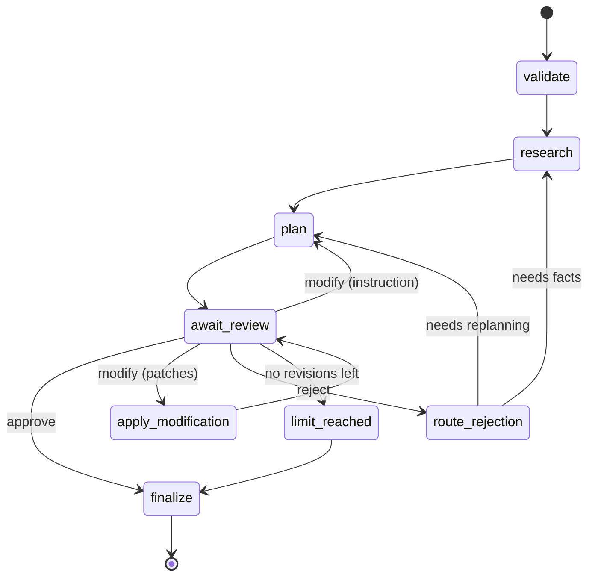

# Architecture

## The shape of the problem

A travel plan takes tens of seconds of model latency to produce and then has to stop
and wait for a person. Those two facts drive most of the design.

The waiting is the harder of the two. A pause that lives in a held HTTP connection, or
in a Python object on one worker, is not really a pause — it is a timeout waiting to
happen and a restart waiting to lose someone's plan. So the pause is a checkpoint: the
workflow writes its entire state to disk, unwinds, and is resumed later by a different
request that may land on a different process.

## Layers

```
api/          HTTP surface: routes, request/response bodies, error translation
services/     Composition root and the workflow's two entry points
graph/        The LangGraph orchestrator: state, nodes, edges
agents/       The two specialised agents and the loop they share
tools/        What the agents can call
prompts/      Versioned templates
domain/       The models everything above agrees on
persistence/  The plan store and the checkpointer
core/         Config, logging, caching, HTTP, resilience, errors
llm/          Provider abstraction and the failover chain
```

Dependencies point downward only. `domain` imports nothing above it; `core` imports
nothing from the application at all. No module reaches for a global — the runtime is
built once in `services/runtime.py` and passed down, which is what lets the whole
system be instantiated against temporary files and an offline model in a test.

## The workflow



`await_review` calls `interrupt()`. Everything to its left runs on the `POST /plan`
request; everything to its right runs on a `POST /plan/{id}/review` request. The two
halves share nothing but the checkpointed state.

Three properties of this graph are deliberate:

**Rejections are classified before they are routed.** The assignment asks for routing
to "the appropriate agent(s)". Sending every rejection back to the planner would be
simpler, but a complaint that the plan misses the food markets cannot be fixed by
rearranging a brief that never mentioned them. `route_rejection` asks the model which
of the two problems it is looking at, and falls back to the planner — the cheaper path
— when it cannot tell.

**Every revised draft returns to the review gate.** `apply_modification` and the
replanning branches all lead back to `await_review` rather than forward to `finalize`.
Nothing reaches the final plan without a human having seen it in the state it will
ship in.

**The loop is bounded.** Each non-approval consumes a revision. When the configured
ceiling is reached, the next decision routes to `limit_reached`, which finalises the
current draft and records `revision_limit_reached: true` on it. A reviewer who keeps
rejecting ends up with a plan and an honest note, rather than an infinite loop or an
error.

## The two agents

Both are the same machine with different tools and prompts: a bounded reasoning loop
where the model calls tools and reads their output, then a single structured-output
call that turns the transcript into a typed object.

The split matters for small free-tier models, which are noticeably worse at using
tools and emitting valid JSON in the same turn than at doing either alone.

| | Research agent | Planner agent |
|---|---|---|
| Tool 1 | `web_search` — Serper or Exa | `budget_allocator` — category split + FX |
| Tool 2 | `destination_conditions` — Open-Meteo | `day_feasibility_check` — pacing, budget, weather |
| Produces | `ResearchBrief` | `DraftItinerary` |

### What the model is not allowed to contribute

This is the single most load-bearing decision in the agent layer. Several facts pass
*around* the model rather than through it:

- **Sources.** The web search tool records every URL the provider actually returned.
  The brief's `sources` come from that record, never from the model's recollection of
  what it read. A citation in the final plan is therefore a page that genuinely
  appeared in a search result.
- **Location and weather.** Recorded by the conditions tool, attached to the brief
  directly.
- **The budget split.** Recorded by the allocator, attached to the itinerary directly.
- **Day numbers and dates.** The planner emits *flat rows* — every activity and meal
  tagged with a day number — and `PlannerAgent._assemble` groups them, assigning dates
  from the request. `DraftItinerary` requires days numbered consecutively from one, and
  that invariant holds by construction because the model never numbers a day. Rows
  naming a day outside the trip are dropped and the correction is logged.

  The flat shape is also what makes the planner work at all on free-tier models. Asked
  for the nested form a person would model — a list of days, each holding a list of
  activities — they return the outer list empty rather than admit they cannot build it.
  Asked for one array of simple rows, the same models answer reliably.

The agents emit their own schemas (`agents/schemas.py`) rather than the domain models,
precisely so the domain's invariants are never something a model has to maintain.

## Tools

Every tool is built by a factory closing over a `ToolContext` — settings, HTTP client,
cache, circuit breakers — rather than importing them. All outbound calls go through
`guarded_call`, which applies caching, the circuit breaker and failure bookkeeping in
one place, so a new tool gets them by using it rather than by remembering to
reimplement them.

The cache is consulted *before* the breaker, so a destination already researched still
answers while the provider is unhealthy.

**Only raw provider payloads are cached, never domain models.** The disk cache outlives
the process, so a pickled model written by an older build comes back with whatever field
types that build used — bypassing validation entirely. Caching the JSON and parsing
after every read means a model change can never be replayed past its own validators.

Tool failures are returned to the model as text, not raised. A failed search should let
the agent try a different angle; only a failure of the model itself aborts a run.

Two tools deserve a note on why they exist at all:

**`destination_conditions`** distinguishes a genuine forecast from climate normals. A
real forecast only exists inside the provider's ~16-day horizon; beyond it the tool
averages the same calendar window across recent years and labels the result as such.
Presenting a multi-month-out average as a forecast would be exactly the fabrication the
tool exists to prevent.

**`day_feasibility_check`** is deterministic and checks a proposed day against facts
the workflow already holds — the weather the research agent gathered, the envelope the
allocator produced, and configured pacing thresholds. It reports rather than rejects,
because a flagged day is usually the right day once an indoor fallback is added.

## Persistence: two stores, two jobs

**The checkpointer** (`langgraph-checkpoint-sqlite`) holds the workflow state. This is
what makes the pause durable.

**The workflow state holds data, not objects.** Domain models go into the checkpoint as
the JSON their `model_dump(mode="json")` produces, and are rebuilt by the node that
needs them. The checkpointer encodes with msgpack, which understands JSON primitives and
nothing else; storing live models pushed pydantic objects into the encoder, where they
failed. Msgpack names only the outermost type in its error, so every such failure
reported the same useless `DraftItinerary` whatever the real culprit was. Round-tripping
through JSON also re-validates every read, so a checkpoint written by an older build
cannot smuggle a stale shape into a running one.

**The plan table** (SQLAlchemy + Alembic) holds the query surface the checkpointer does
not provide. Answering "what is the status of plan X" by deserialising a LangGraph
checkpoint would mean loading an entire conversation to read one field, and "which
plans are awaiting review" would mean loading all of them.

`PlanRepository.project` writes the queryable parts of a workflow state onto the row
after every run. It is idempotent — a resumed run re-projects a plan that already
exists — and it never blanks out an artefact the new state does not carry.

The larger documents are stored as JSON rather than shredded into tables: they are
written and read whole, always by primary key, and their shape is owned by the domain
models. Normalising them would turn every itinerary field change into a migration.

The checkpoint serializer is given an allowlist derived from the domain package.
LangGraph's default will reconstruct any type a checkpoint names, which is a real
hazard rather than a nuisance — anything able to write to that database could otherwise
name a type to instantiate.

## Models and failover

Business logic never names a vendor. Agents ask `ModelRegistry` for a chain and get a
LangChain runnable; which company serves the tokens is a `.env` edit.

The chain is a list of *candidates*, not of vendors. Each candidate is one
(provider, key, model) combination, and they are tried in order until one answers. That
distinction is what makes the failover useful: free tiers meter per key and per model,
so when a Groq key has spent its tokens-per-minute allowance on one model, the next
attempt worth making is a different key or a different model — not necessarily a
different company. Vendors are still ordered deliberately, and every key is tried
against every model before the chain moves on. Adding either widens the chain with no
code change.

Providers with no key configured are dropped when the chain is assembled, rather than
being allowed to fail on first call — an unconfigured fallback costs no latency.
Failover happens *within* a single call, so an agent mid-reasoning does not abort
because the primary hit its quota.

One subtlety: failover only advances when a call *raises*. A model that returns an empty
object has succeeded by that measure, so a plain retry would land on the same candidate
and get the same emptiness. Callers that can judge their own output pass a `skip` count,
which starts the chain further down and escalates on each attempt.

Ollama is the one provider with no quota at all. It needs no credential, so it counts as
configured whenever it is named in the chain, and it works best listed *ahead* of the
hosted providers rather than instead of them — absorbing the load until it struggles,
then handing over. Its cost is capability: small local models are markedly weaker at the
two things the agents need, tool calling and structured output. `OLLAMA_NUM_CTX` matters
more than it looks. A context window larger than the GPU can hold spills the KV cache
into system RAM, and the same 4B model that answers a planner-shaped extraction in 17
seconds at 16K took over six minutes at 64K.

If no provider is configured at all, the chain resolves to an offline provider. A fresh
clone boots, serves `/health`, answers every endpoint and passes its whole test suite
before anyone has signed up for anything. `/ready` says plainly that plans will be
placeholders.

## Failure handling

| Failure | Response |
|---|---|
| A tool call fails | Returned to the model as text; the agent continues |
| A provider fails or rate-limits | Next provider in the chain, mid-call |
| A dependency fails repeatedly | Circuit opens; cached answers still served |
| Search quota exhausted | Tool refuses further queries in prose; agent winds down |
| Weather unavailable | Plan proceeds and says it has no weather-specific basis |
| FX unavailable | Budget is produced without a local-currency view |
| The finaliser fails | Plan is still delivered, without packing lists |
| A structured extraction comes back empty | Retried up to `LLM_EXTRACTION_ATTEMPTS`, then accepted as a thin draft the reviewer can reject |
| A model returns a non-URL citation | The citation is dropped; the activity is kept |
| A model call fails entirely | Run fails; plan marked `failed` with the reason |

Errors carry their own HTTP status and a stable machine-readable code, so one handler
covers the hierarchy and a new failure mode is translated correctly without touching a
route. Responses follow RFC 7807. Context attached to an exception stays in the logs —
it exists to make an incident diagnosable and may name internal services.

## Request lifecycle

1. `POST /plan` validates the body, checks it against operational ceilings, inserts a
   plan row, schedules the run, and returns **202** with an id.
2. The background run validates, researches, plans, and hits the interrupt. The state
   is checkpointed; the row is updated to `awaiting_review`.
3. `GET /plan/{id}` reports the stage. While paused it also returns `review_request` —
   the interrupt's own payload, including a rendered view of the draft and how many
   revisions remain.
4. `POST /plan/{id}/review` resumes the graph from the checkpoint. Structured patches
   are dry-run against the current draft first, so an unapplyable patch is a **422**
   that leaves the interrupt unconsumed and the plan exactly where it was.
5. `GET /plan/{id}/final` serves the approved plan, or **409** naming the current
   status.
